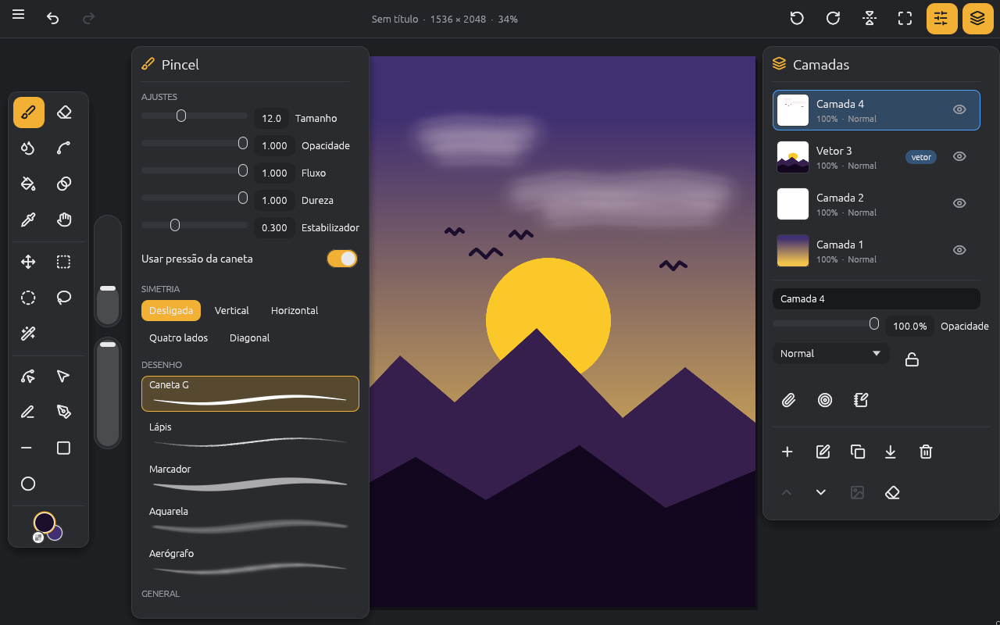
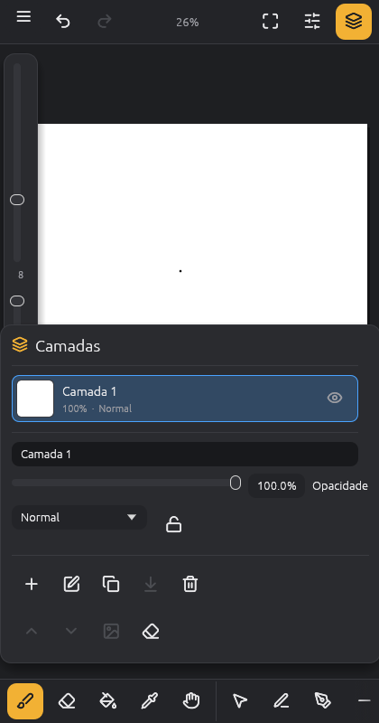

# ArtApp

App de desenho e pintura digital, raster e vetorial, no estilo Clip Studio Paint / Adobe, feito
para rodar no **Android** (e também no desktop, para desenvolver e testar).



## Interface

A tela de desenho ocupa a janela inteira e os controles flutuam por cima, no estilo Procreate /
Clip Studio (o desenho da interface partiu de um protótipo feito no Lovable): trilho de ferramentas
com ícones à esquerda, sliders verticais de tamanho e opacidade, painel da ferramenta (pincéis com
amostra do traço), painel de camadas com miniaturas, seletor de cor com cores recentes e avisos que
somem sozinhos. No celular em pé, as ferramentas vão para uma barra embaixo e os painéis viram folhas
que sobem de baixo.



## O que já faz

- **Pincéis** do motor do [PhotoCraft](https://github.com/storytold/photocraft): os presets
  embutidos (General, Dry Media, Wet Media…) e pincéis de linha do ArtApp (Caneta G, Lápis, Marcador,
  Aquarela, Aerógrafo), com pressão da caneta, estabilizador, opacidade, fluxo e dureza.
- **Pincéis profissionais**: editor completo (ponta, textura do papel, dispersão, pincel duplo,
  início e fim do traço…) e pincéis próprios salvos no app.
- **Misturar e retocar** (motor do PhotoCraft): desfocar, dedo, clarear, escurecer, saturar,
  tirar saturação e carimbo.
- **Liquefazer**: empurrar, deslocar, torcer (horário e anti-horário), contrair, inflar, suavizar e
  restaurar.
- **Degradê** linear ou radial (principal → secundária ou transparente) e **simetria** vertical,
  horizontal, de quatro lados ou diagonal, com ângulo ajustável.
- **Vetor pro**: todas as ferramentas do VectorCraft (seleção direta e de grupo, editar/converter
  pontos, curvatura, texto, segmento, arco, espiral, grades…) na camada vetorial.
- **Filtros** do PhotoCraft (quase 30: desfoques, nitidez, ruído, mosaico, pintura a óleo,
  ondulação…), **transformar camada** e **correção de cor**, no menu.
- **Borracha**, **balde de tinta** (amostra todas as camadas, com tolerância) e **conta-gotas**.
- **Camadas**: nova, duplicar, apagar, subir/descer, mesclar abaixo, limpar, mostrar/ocultar,
  opacidade, 26 modos de mesclagem (Multiplicar, Tela, Sobrepor…) e bloquear transparência.
- **Camadas vetoriais** com o motor do [VectorCraft](https://github.com/storytold/vectorcraft)
  (menu **Vetor**): caneta Bézier (toque põe pontos, arrastar curva, tocar no primeiro ponto fecha),
  caneta vetorial à mão livre (o traço vira curvas ajustadas), linha, retângulo, elipse, seleção para
  mover/recolorir/apagar objetos, balde que pinta o preenchimento da forma e borracha que apaga o
  objeto tocado. Usar uma ferramenta vetorial numa camada raster cria uma camada vetorial; dá para
  rasterizar uma camada vetorial para pintar por cima.
- **Recursos de camada do Clip Studio**: recortar na camada abaixo (clipping), camada de referência
  (o balde olha só ela, por exemplo o lineart) e camada de rascunho (aparece na tela, mas fica fora
  da exportação e do balde).
- **Seleção** retangular, elíptica, laço e varinha mágica: pincel, balde e limpar só agem dentro dela. O lançador
  embaixo da seleção desmarca, inverte, limpa, preenche e chama Mover camada (atalhos Ctrl+D,
  Ctrl+Shift+I, Ctrl+A, Delete).
- **Mover camada** arrastando o conteúdo.
- **Cores principal e secundária** (X troca) e **cor transparente** (pincel e balde apagam), no pé
  do trilho de ferramentas.
- **Girar e espelhar a vista** pela barra de cima ou com dois dedos; Encaixar desfaz o giro.
- **Desfazer/refazer** (100 passos).
- **Zoom e pan**: pinça com dois dedos no Android; roda do mouse e botão do meio/direito no desktop;
  ferramenta Mão.
- **Exportar PNG** (com papel branco ou transparente). No Android vai para `Pictures/ArtApp`; se o
  aparelho não deixar, para a pasta do app em `Android/data/io.github.rafanunesran.artapp/files`.

## Próximos passos

1. Editar pontos Bézier de objetos existentes (seleção direta) e espessura variável pela pressão.
2. Salvar/abrir projeto com camadas (e salvamento automático no Android).
3. Réguas de perspectiva, pastas e máscaras de camada.
4. Compartilhar a imagem pelo menu do Android e importar fotos.

## Arquitetura

Tudo é Rust. A interface é [egui](https://github.com/emilk/egui) (via `eframe`, OpenGL ES), que roda
nativa no Android pela `NativeActivity` — sem WebView.

| Pasta | O que é |
|---|---|
| `crates/artapp-core` | Documento, camadas raster e vetoriais, traços, histórico, composição, balde e PNG. Sem interface; tem os testes. |
| `crates/artapp` | O app (egui): tela de desenho, toques e gestos, painéis. Biblioteca `cdylib` para o Android e binário para o desktop. |
| `android/` | Projeto Gradle mínimo que empacota `libartapp.so` num APK. |

`third_party/epaint` é uma cópia do `epaint` 0.37 com uma correção de uma linha para conviver com o
renderizador do VectorCraft (detalhes em `third_party/epaint/ARTAPP-PATCH.md`).

Os crates do PhotoCraft e do VectorCraft entram como dependências Cargo fixadas por
revisão de git, então dá para atualizar o motor trocando o `rev` no `Cargo.toml` da raiz.

## Rodar no desktop

```sh
cargo run -p artapp --release
cargo test --workspace
```

No Linux, precisa de `libxkbcommon-x11` e de OpenGL.

## Baixar

Site: **https://rafanunesran.github.io/ArtApp/** (código em `site/`). O APK mais recente fica em
[Releases](https://github.com/rafanunesran/ArtApp/releases/latest): cada push na `main` que passa
nos testes publica uma release com `ArtApp.apk`. Instale no celular permitindo "instalar apps
desconhecidos".

Link direto, sempre para o APK mais novo (bom para salvar nos favoritos do celular):
**https://github.com/rafanunesran/ArtApp/releases/latest/download/ArtApp.apk**

Todo APK é assinado com a mesma chave e tem `versionCode` maior que o anterior, então basta baixar
e tocar em "Atualizar": o Android instala por cima, sem desinstalar e sem perder os desenhos.

A mesma release traz as versões para computador:

| Sistema | Arquivo | Como abrir |
|---|---|---|
| Windows 10/11 | `ArtApp-Windows-x64.zip` | Extraia e abra `ArtApp.exe` (no aviso do SmartScreen: "Mais informações › Executar assim mesmo"). |
| Linux x64 | `ArtApp-Linux-x64.tar.gz` | Extraia e rode `./install.sh` (põe no menu) ou `./artapp`. |
| macOS (M1/M2/M3…) | `ArtApp-macOS-AppleSilicon.zip` | Extraia, arraste `ArtApp.app` para Aplicativos e abra com botão direito › Abrir na primeira vez. |
| macOS Intel | `ArtApp-macOS-Intel.zip` | Igual ao de cima. |

Os apps de computador ainda não têm assinatura paga (Microsoft/Apple), por isso o aviso na
primeira abertura.

## Gerar o APK

O GitHub Actions (`.github/workflows/android.yml`) gera o APK em cada push; além da release, ele
fica em **Actions › CI › Artifacts › artapp-apk**.

Localmente, com o Android SDK e o NDK instalados:

```sh
rustup target add aarch64-linux-android x86_64-linux-android
cargo install cargo-ndk
cargo ndk -t arm64-v8a -t x86_64 -P 26 -o android/app/src/main/jniLibs build --release -p artapp --lib
cd android && ./gradlew assembleRelease
# APK em android/app/build/outputs/apk/release/
```

No CI o APK é assinado com uma chave fixa (PKCS12, alias `artapp`, mesma senha para a chave e o
arquivo) guardada nos segredos `ARTAPP_KEYSTORE_BASE64` (o `.p12` em base64) e
`ARTAPP_KEYSTORE_PASSWORD` do repositório (Settings › Secrets and variables › Actions). Sem a
senha (por exemplo num build local), o Gradle usa a chave de debug e o `versionCode` fica 1.

## Licença

MIT OU Apache-2.0, à sua escolha. Créditos de terceiros em [NOTICE](NOTICE).
