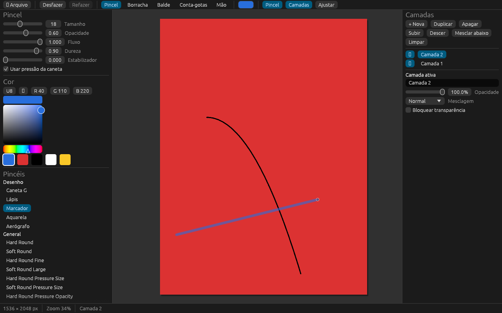
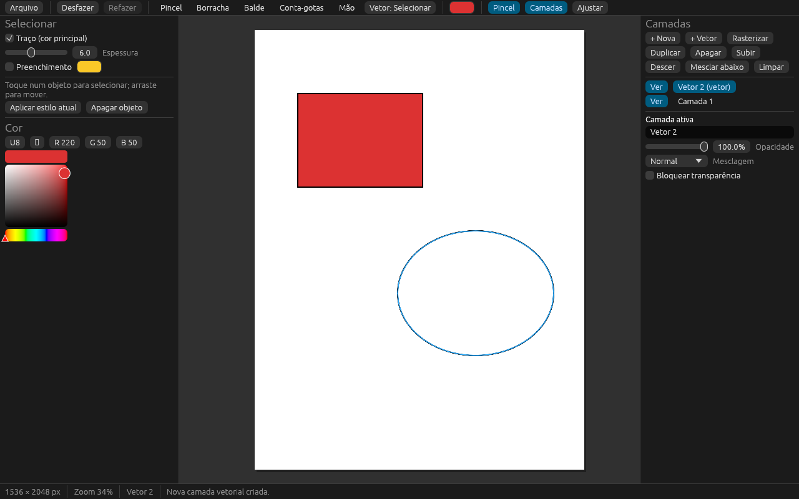

# ArtApp

App de desenho e pintura digital, raster e vetorial, no estilo Clip Studio Paint / Adobe, feito
para rodar no **Android** (e também no desktop, para desenvolver e testar).



## O que já faz

- **Pincéis** do motor do [PhotoCraft](https://github.com/storytold/photocraft): os presets
  embutidos (General, Dry Media, Wet Media…) e pincéis de linha do ArtApp (Caneta G, Lápis, Marcador,
  Aquarela, Aerógrafo), com pressão da caneta, estabilizador, opacidade, fluxo e dureza.
- **Borracha**, **balde de tinta** (amostra todas as camadas, com tolerância) e **conta-gotas**.
- **Camadas**: nova, duplicar, apagar, subir/descer, mesclar abaixo, limpar, mostrar/ocultar,
  opacidade, 26 modos de mesclagem (Multiplicar, Tela, Sobrepor…) e bloquear transparência.
- **Camadas vetoriais** com o motor do [VectorCraft](https://github.com/storytold/vectorcraft)
  (menu **Vetor**): caneta Bézier (toque põe pontos, arrastar curva, tocar no primeiro ponto fecha),
  caneta vetorial à mão livre (o traço vira curvas ajustadas), linha, retângulo, elipse, seleção para
  mover/recolorir/apagar objetos, balde que pinta o preenchimento da forma e borracha que apaga o
  objeto tocado. Usar uma ferramenta vetorial numa camada raster cria uma camada vetorial; dá para
  rasterizar uma camada vetorial para pintar por cima.
- **Desfazer/refazer** (100 passos).
- **Zoom e pan**: pinça com dois dedos no Android; roda do mouse e botão do meio/direito no desktop;
  ferramenta Mão.
- **Exportar PNG** (com papel branco ou transparente). No Android vai para `Pictures/ArtApp`; se o
  aparelho não deixar, para a pasta do app em `Android/data/io.github.rafanunesran.artapp/files`.

## Próximos passos

1. Editar pontos Bézier de objetos existentes (seleção direta) e espessura variável pela pressão.
2. Salvar/abrir projeto com camadas (e salvamento automático no Android).
3. Seleção (laço, retângulo), transformar, réguas e simetria.
4. Compartilhar a imagem pelo menu do Android e importar fotos.



## Arquitetura

Tudo é Rust. A interface é [egui](https://github.com/emilk/egui) (via `eframe`, OpenGL ES), que roda
nativa no Android pela `NativeActivity` — sem WebView.

| Pasta | O que é |
|---|---|
| `crates/artapp-core` | Documento, camadas raster e vetoriais, traços, histórico, composição, balde e PNG. Sem interface; tem os testes. |
| `crates/artapp` | O app (egui): tela de desenho, toques e gestos, painéis. Biblioteca `cdylib` para o Android e binário para o desktop. |
| `android/` | Projeto Gradle mínimo que empacota `libartapp.so` num APK. |

`third_party/epaint` é uma cópia do `epaint` 0.37 com uma correção de uma linha para conviver com o
renderizador do VectorCraft (detalhes em `third_party/epaint/ARTAPP-PATCH.md`).

Os crates do PhotoCraft e do VectorCraft entram como dependências Cargo fixadas por
revisão de git, então dá para atualizar o motor trocando o `rev` no `Cargo.toml` da raiz.

## Rodar no desktop

```sh
cargo run -p artapp --release
cargo test --workspace
```

No Linux, precisa de `libxkbcommon-x11` e de OpenGL.

## Gerar o APK

O jeito mais fácil: cada push roda o GitHub Actions (`.github/workflows/android.yml`) e o APK fica
em **Actions › CI › Artifacts › artapp-apk**. Baixe, descompacte e instale no celular (permita
"instalar apps desconhecidos").

Localmente, com o Android SDK e o NDK instalados:

```sh
rustup target add aarch64-linux-android x86_64-linux-android
cargo install cargo-ndk
cargo ndk -t arm64-v8a -t x86_64 -P 26 -o android/app/src/main/jniLibs build --release -p artapp --lib
cd android && ./gradlew assembleRelease
# APK em android/app/build/outputs/apk/release/
```

O APK de release ainda é assinado com a chave de debug (bom para instalar direto, não para a Play
Store).

## Licença

MIT OU Apache-2.0, à sua escolha. Créditos de terceiros em [NOTICE](NOTICE).
